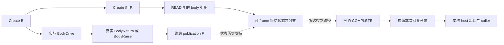

# 无Drive请求：模型连接与查询边界

完整计划见[M1_ASYNC_CLOSE_CONTINUATIONS_PLAN.md](M1_ASYNC_CLOSE_CONTINUATIONS_PLAN.md)。
这里说明本批设计合同；实际已验结果以验收报告和不可覆盖的attempt为准。

## 原图如何表达

仍使用五类实体，不增加“closed request”业务节点。创建、读取、判断、写入、构造
异常与调用都是Operation；引用、bool、异常包和状态版本是Value；frame/request字段
是StateLocation；函数与body是Region；frame/存储的实现保留Resource及其已有关系。

这只是展示投影，规范producer/use仍在原表。B引用被传递不等于B可变内容没变化。
F的来源是前一次真实body terminal；后续R.COMPLETE不能反向生成F。异常构造的
新结果受原分支控制，不是旧body异常包的copy。constructor自己的RAISE也必须
使用本次失败包与自己的全state，不能借旧包。

## 独立查询

`ProgramIndex.request_no_drive_paths(scope=None, *, budget=4096)` 使用自己的预算，
不改变旧protocol分析预算。scope只筛选明确请求的范围；缺省分母来自原
ASYNC_REQUEST DriverInterface及ASYNC_GENERATOR body，不靠可删除附件。

准备库存保留原entry、R/S角色、Operation、BRANCH、INVOKE的全部N/R槽、host
终点和BodyDrive。遍历只沿原CFG，保留有序的原边、当前state以及本路径实际
选中的own completion。首Drive、首host、cycle或未展开边界分别报告。

- 到首host且完整prefix无显式BodyDrive：`declared_no_drive=True`。
- 到首BodyDrive：`False`。
- 预算/循环/未解控制边界：`None`，保留cursor，不能将未访问当不存在。

这是**所供driver Region中的局部结构属性**。opaque callee/native内部可能有
额外行为；本查询不证明这些内部没有驱动，也不证明真实程序与所供图相符。
`known_inventory_complete`仅表示本地路线枚举完整；native/source/runtime身份与
变换权限继续false。原async报告只增加廉价`request_no_drive_inventory`。

## 按角色解析关联

finished分支只需R→B；不能为了旧双结果marker而制造一次并未发生的latent读取。
使用既有`RequestAssociation`：body指向准确own READ结果，latent明确为
`StaticProtocolGap`。body投影从原R来源/Create.body输入和caller选择上下文建立；
它是**依赖该关联合同的条件推导**，不是普通copy闭包的新规则。

字段地址说明读了哪处状态，不证明返回值必等于Create.body。字段名、相同Ref
类型、相同snapshot也不授这种等价。body角色库存完整不等于整体关联完整；latent
未检查/缺失仍明确保留，不能变成已证明来源或纯函数。

## 验收要核什么

原库存、自己N/R结果、最后状态槽和所选路径分别核对；删附件或budget1不能
减少原操作分母。动态capture必须从真terminal/F到同B的新R，新调用无额外
BodyDrive/segment；实例缺采不能借完整兄弟。测试只能核所供结构的合法组合，
不能算自动拆解任意程序、LeWM变换或性能结果。

当前新增driver是finished-case的**所供片段**。非finished分支保持未展开primitive，
`native_cfg_complete=False`，不代表真实athrow/aclose的完整未选路径。具体的异常
类别/回复语义也不从constructor名称推出，仍需独立native/source映射。
动态`body_state_history`跨body-only association的历史主体桥尚未接通；本次True
分支与已有F都在库存中，仍不足以让该查询推出expected True。这两个缺口使
F19第1项继续OPEN，不能拿此API或测试数提前关闭整个协议或第一阶段。
